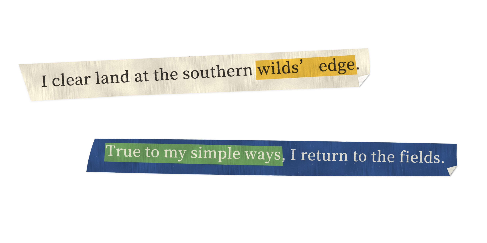
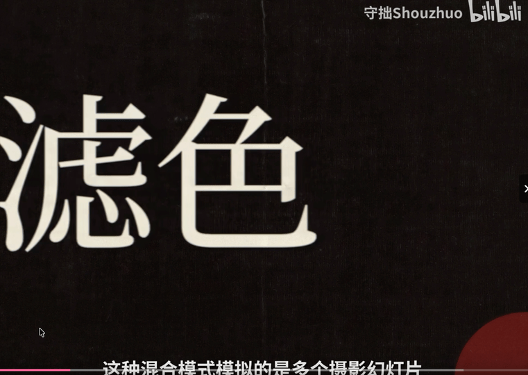

**English** | [简体中文](README.zh-CN.md)

# Shouzhuo · Ink Collage



## In a video

An animated example of this effect in one of my videos.



[Watch on Bilibili: A playful look at blend modes — Screen](https://www.bilibili.com/video/BV1qoaa6KEHs/?t=6) · The effect appears at **0:06–0:15**.

---

Cut a strip of paper, print ink-textured lettering on it, and paste a smaller piece of colored paper behind the words you want to highlight. A folded corner rests over the front and trembles in a stop-motion rhythm. The default typeface is Source Han Serif. Four entrance animations come with matching paper sounds, and the preview can export 4K transparent images and lossless video.

Ink Collage is a JavaScript library rendered in WebGL2, with no framework or build-tool dependencies. The `preview/` page provides four palettes, a font-size control, **Shape** and **Texture** sliders, four entrances, a **Recut** button, and export controls. For more customization, edit the source.

**Live demo:** [Open Ink Collage](https://shouzhuo03.github.io/shouzhuo-ink-collage/).

Run locally:

```bash
python3 tools/serve.py
```

Then open <http://localhost:8137/>. A WebGL2-capable browser is required: Chrome, Edge, Firefox, or Safari 15 and later.

## Quick start

```js
import { InkStrip, loadFont } from './src/index.js';

await loadFont(); // Load the bundled Source Han Serif subset.
const strip = new InkStrip({ width: 1280, height: 720 });
document.body.append(strip.canvas);

strip.set({
  text: '此效果类似于多个[摄影幻灯片]在彼此之上投影。', // [brackets] or 【brackets】 mark highlighted words.
  fontSize: 56,
  shape: 0.3,      // Letterform wear: 0..1.
  texture: 0.3,    // Ink texture: 0..1.
  palette: 'navy', // navy, cream, kraft, vermilion, or a custom palette.
});

const tick = (ms) => {
  strip.render(ms / 1000);
  requestAnimationFrame(tick);
};
requestAnimationFrame(tick);
```

`render(time)` takes seconds. At rest, only the folded corner moves, in steps controlled by `curl.fps` (8 frames per second by default). Entrances step at 15 frames per second. Given the same parameters and time, the renderer produces the same pixels, which makes frame-by-frame export deterministic.

## Shape and Texture

| Slider | Minimum | Maximum |
|---|---|---|
| Shape `shape` | Original letterforms with sharp corners | Rounded corners, ragged edges, and ink bleed, eventually making the letters difficult to read |
| Texture `texture` | Solid ink, like the original font | Thin, broken ink full of grain and pinholes, with the paper showing through |

Each slider maps to a group of finer parameters through `lookFor()` in `src/look.js`. All effect lengths use **em units**, relative to the font size. A setting therefore keeps the same proportions at 20px and 200px: rounding and edge wear shrink with the letters instead of disappearing. Ink grain is never finer than 1.25 device pixels, so it remains visible at small sizes.

Override individual parameters with `look`:

```js
strip.set({ shape: 0.4, look: { bleed: 0, rough: 0.03 } });
```

## The paper strip

- **Cut edges:** each edge has its own slight slant, curve, or kink, like scissors cutting in more than one stroke. Corners stay sharp. The lettering stays inside the paper. Change `seed` to generate a different cut, paper texture, and ink pattern.
- **Highlights:** words inside `[ ]` or `【 】` receive a smaller cut-paper patch behind them. A highlight spanning multiple lines gets a separate patch on each line.
- **Paper:** mostly vertical fibers form streaks that vary in visibility, alongside cloudy pulp, pale flecks, and occasional dark specks. Paper texture uses CSS-pixel units and does not scale with the font size; adjust `paperScale` to change its scale.
- **Front and back:** the folded corner reveals the back of the paper. Colored paper has a pale back, while light paper uses a different shade of white. Each palette defines this through `back`.
- **Background:** the page is white by default (`background`). Set it to `null` for transparency. A subtle contact shadow (`shadow`) places the strip on the page.

## Folded corner

The fold works like CC Page Turn in After Effects.

```js
strip.set({ curl: { corner: 'br', size: 0.3, radius: 0.04, jitter: 1, fps: 8, freq: 1.5 } });
strip.set({ curl: false }); // Disable the fold.
```

| Parameter | Default | Meaning |
|---|---|---|
| `corner` | `'br'` | Corner to fold: `tl`, `tr`, `br`, or `bl` |
| `size` | 0.3 | Fold size as a share of the strip's shorter side |
| `radius` | 0.04 | Bend radius as a share of `size`; small values produce a pressed fold, larger values a rounder curl |
| `jitter` | 1 | Tremble amount; 0 keeps the fold still |
| `fps` | 8 | Stepped frame rate, like AE's `posterizeTime` |
| `freq` | 1.5 | Tremble frequency, like AE's `wiggle` frequency |
| `shadow` / `lift` | 0.32 / 1 | Fold-shadow strength and apparent lift |

## Entrance animations

Four fixed-length entrances run at 15 frames per second. Each has a paper sound of the same duration.

| Name | Preview button | Frames | Motion |
|---|---|---|---|
| `unfurl` | 揭角 | 10 (0.67 s) | A large fold initially covers most of the strip, with the flap pointing toward the upper left. The fold opens in stepped poses, settles into a small corner, and resumes trembling. |
| `snap` | 回正 | 6 (0.4 s) | The strip starts tilted by 11 degrees and slightly low, with a folded section covering its left end. It snaps upright, nudges upward, and opens the left fold. |
| `slap` | 拍下 | 9 (0.6 s) | The strip starts slightly above the page, larger and casting a softer, more distant shadow, with two lifted corners. It presses flat and gives a small settling shake. |
| `slide` | 滑入 | 10 (0.67 s) | The strip pushes in from the left with its leading corner lifted, then stops as the corner settles into its usual small fold. |

These are deliberately trimmed entrances: the strip is already visible in the first frame rather than traveling all the way in from offscreen.

```js
strip.play('unfurl', now); // Use the same clock, in seconds, as render().
strip.render(now + 0.2);   // Hidden before the entrance; returns to its resting tremble afterward.
```

Durations, frame counts, and keyframes live in `src/entries.js`. Edit the source to change them; the preview does not expose those settings.

### Sound

`sounds/` contains four mono, 44.1 kHz WAV files, trimmed to match the entrances. They come from Kenney's [Casino Audio](https://kenney.nl/assets/casino-audio), released under CC0. Commercial use is allowed and attribution is optional; see `sounds/LICENSE-Kenney.txt`.

| File | Original sound | Timing |
|---|---|---|
| `unfurl.wav` | card-slide-8 | Starts quietly and peaks at 0.26 s, matching a large jump in the fold |
| `snap.wav` | card-place-2 | A short slap, padded by 0.06 s, lands at 0.24 s as the strip snaps into place |
| `slap.wav` | card-place-4 | Peaks at 0.32 s, matching the fifth animation frame as the strip presses onto the page |
| `slide.wav` | card-shove-3 | A push followed by a longer slide matches the fast start and slow finish |

```js
import { EntrySounds } from './src/index.js';
const sounds = new EntrySounds();
await sounds.load();
button.onclick = () => {
  sounds.play('slap');
  strip.play('slap', performance.now() / 1000);
};
```

Browsers require a user gesture, such as a click or key press, before playing sound. In a video editor, place the matching file from `sounds/` at the entrance's first frame.

## Export

Use the export button (导出) at the bottom of the preview panel.

| Option | Format | Contents |
|---|---|---|
| Image | PNG, 3840 × 2160, transparent | The strip in its resting pose |
| Video | MOV, 3840 × 2160, 30 fps, transparent, lossless, with audio | The selected entrance followed by 2 seconds of resting tremble, with its matching sound |

Video uses QuickTime **PNG encoding**: each frame is a lossless PNG with straight alpha. After Effects and Premiere can import it directly. macOS QuickTime Player and Final Cut no longer support this codec, so they cannot open these files. Convert to ProRes 4444 with ffmpeg if needed; that conversion is not lossless:

```bash
ffmpeg -i input.mov -c:v prores_ks -profile:v 4444 -pix_fmt yuva444p10le -c:a pcm_s16le output.mov
```

Exports render a 1920 × 1080 composition at 2× resolution, producing 4K output. The preview shows that same composition. Lengths such as `fontSize` are relative to the 1920 × 1080 composition.

Export from code:

```js
import { exportImage, exportVideo } from './src/index.js';
const png = await exportImage(strip.params); // Blob.
const mov = await exportVideo(strip.params, 'unfurl', { // Blob.
  hold: 2, // Seconds of resting tremble after the entrance.
  onProgress: (done, total) => console.log(done, '/', total),
});
```

Identical frames are encoded only once. In testing on a Mac, a 2.7-second 4K export took less than a second and produced a file of roughly 110 MB; the size depends on the strip. `writeMov()` is a standalone MOV writer that can also package other PNG sequences.

## Placement

Update `x` and `y` (the strip center in CSS pixels, centered by default), `rotate` (degrees), `scale`, and `opacity` on every frame without rebuilding textures. Entrance transforms are added to these values.

## Palettes

```js
strip.set({ palette: { paper: '#2e4a7a', back: '#dcd9ce', ink: '#efe8d6', highlight: '#68975b', highlightInk: '#efe8d6' } });
```

`ink` is the main text color; `highlightInk` is the text color on highlight patches. Light ink on dark paper and dark ink on light paper are both supported. Dark ink reveals a warm fringe where its edges grow thin (`fringe`).

## API

- `new InkStrip({ width, height, pixelRatio, canvas, ...params })`
- `strip.set(params)`: merge parameters. Text, font size, and seed changes trigger layout; shape, texture, and palette changes trigger texture baking. Placement and folds can change every frame.
- `strip.render(seconds)`: return `strip.canvas`.
- `strip.play(name, seconds)`: start an entrance on the same clock used by `render()`. Related exports: `ENTRIES`, `entryDuration(name)`, `ENTRY_FPS`, and `EntrySounds`.
- `strip.resize(width, height, pixelRatio?)` and `strip.dispose()`.
- `strip.layout`: the latest glyph positions (including `highlight` flags), strip outline, and highlight outlines in strip-local CSS pixels; useful for custom per-character animation.
- `lookFor(shape, texture)`, `PALETTES`, and `resolvePalette()`.
- `loadFont()`, `layoutText()`, `drawText()`, `parseMarks()`, `fontString()`, `BUILTIN_FAMILY`, and `BUILTIN_FONT_URL`: font and text-layout helpers.
- `cutStrip()`, `cutPatch()`, `wiggle()`, and `rng()`: cut-paper outlines and tremble helpers. `foldsAt()` computes fold geometry at a given time.
- `exportImage(params)`, `exportVideo(params, entrance, options)`, and `EXPORT`: 4K export. `writeMov()` and `readWav()` handle MOV packaging and WAV reading.
- `strip.frameId(seconds)`: identify identical rendered frames, allowing the exporter to avoid encoding duplicates.

## Rendering pipeline

1. Lay out the text and cut-paper outlines, then rasterize masks for text, paper, and highlight patches.
2. Blur the text mask to round the lettering, and the paper mask to build shadows. Bake front and back textures with paper fibers, ink bleed, grain, and pinholes. These textures update only when the content or appearance changes.
3. On each animated frame, composite the background, contact shadow, front surface, fold shadow, and folded-back paper.

The strip is baked into a tightly sized texture before `x`, `y`, `rotate`, and `scale` place it on the canvas. Moving or rotating it therefore does not require rebuilding the texture.

## Project structure

```text
README.md          English documentation (default)
README.zh-CN.md    Simplified Chinese documentation
index.html         Redirect to preview/ for GitHub Pages
src/
  index.js         Public exports
  strip.js         InkStrip: layout, masks, and WebGL2 pipeline
  folds.js         Fold geometry for resting and entrance poses
  entries.js       Keyframes for the four entrances
  look.js          Slider-to-parameter mapping and palettes
  cut.js           Cut-paper outlines and tremble helpers
  shaders.js       GLSL shaders
  text.js          Text layout, font loading, and highlight markup
  sound.js         Entrance sound playback
  export.js        4K image and video export
  mov.js           QuickTime MOV writer (PNG video + PCM audio)
preview/           Interactive demo and Canvas 2D button previews
fonts/             Source Han Serif subset and its license
sounds/            Four entrance sounds (Kenney, CC0) and their license
docs/              Cover images and video example
tools/
  serve.py         Local preview server with caching disabled
  build-fonts.py   Rebuild the font subset from the original font
CREDITS.md         Third-party sources and license notices
```

## Usage and attribution

You may use this project to create video effects and build projects based on its code, subject to the following custom attribution terms:

- **Videos:** credit the author as **@守拙Shouzhuo** in the video description when you publish a video using this project's effects.
- **Projects based on the code:** credit **@守拙Shouzhuo** as the source in your project's README or acknowledgments.
- **A project link is optional.** The author credit above is sufficient; you are not required to include a repository or project URL.

Example video credit: `Ink Collage effect by @守拙Shouzhuo`.

Example project credit: `Built with Ink Collage by @守拙Shouzhuo`.

These attribution terms apply to the author's own project code and effects. Third-party materials retain their original licenses; see [CREDITS.md](CREDITS.md): Source Han Serif (SIL OFL 1.1), Kenney Casino Audio (CC0), and the Lucide scissors icon (ISC). Their applicable license notices must still be preserved.

Paper, ink, cut outlines, and folds are generated procedurally; no reference images are used in the rendering.
