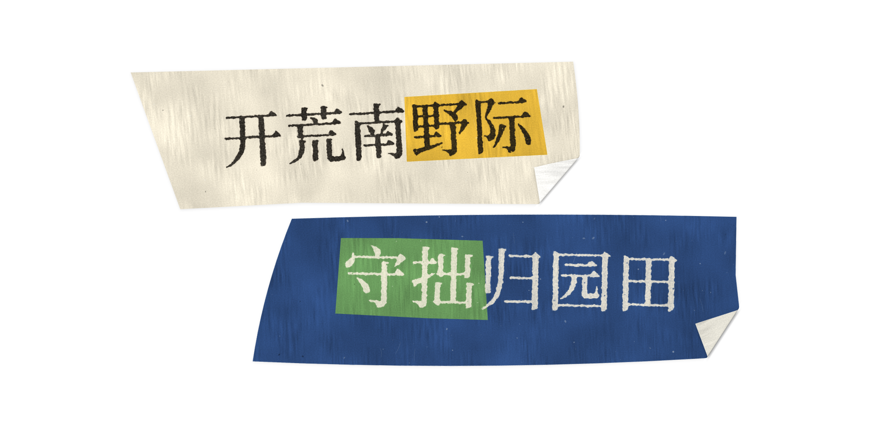
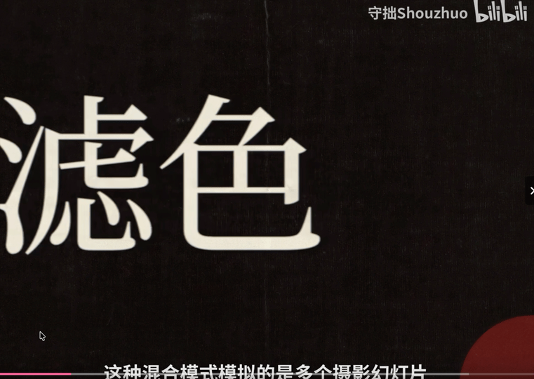

[English](README.md) | **简体中文**

# Shouzhuo · 油墨拼贴



## 视频中的应用

这是我应用在自己视频中的一段动态效果。



[观看 B 站视频《有趣的混合模式之滤色》](https://www.bilibili.com/video/BV1qoaa6KEHs/?t=6) · 效果出现在 **00:06–00:15**。

---

一张剪刀剪出来的纸条，上面印着油墨质感的字，要强调的字底下再贴一小块彩色纸片，纸条的一角折过来压在上面，按定格动画的节奏微微抖动。默认字体是思源宋体。四种入场动画，配好了等长的纸张音效，能导出 4K 透明底的图片和无损视频。

它是一个 JS 库，渲染在 WebGL2 里，不依赖任何框架和构建工具。`preview/` 是快速展示的页面：四种风格、**字形**和**纹理**两个滑块、四种入场、换一种剪法、导出。其余的想个性化就改源码。

**在线演示**：[打开油墨拼贴](https://shouzhuo03.github.io/shouzhuo-ink-collage/)。

本地运行：

```bash
python3 tools/serve.py
```

然后打开 <http://localhost:8137/>。需要支持 WebGL2 的浏览器（Chrome、Edge、Firefox、Safari 15 以上）。

## 快速使用

```js
import { InkStrip, loadFont } from './src/index.js';

await loadFont();                                    // 内置思源宋体
const strip = new InkStrip({ width: 1280, height: 720 });
document.body.append(strip.canvas);

strip.set({
  text: '此效果类似于多个[摄影幻灯片]在彼此之上投影。',  // [方括号] 或 【】 里的字贴高亮纸片
  fontSize: 56,
  shape: 0.3,      // 字形 0..1
  texture: 0.3,    // 纹理 0..1
  palette: 'navy', // navy 藏青 / cream 米白 / kraft 牛皮 / vermilion 朱红，或自己给颜色
});

const tick = (ms) => { strip.render(ms / 1000); requestAnimationFrame(tick); };
requestAnimationFrame(tick);
```

`render(time)` 的参数是秒。平时只有折角会动，按 `curl.fps`（默认每秒 8 格）一格一格地跳；播放入场动画时按每秒 15 格跳（见下面"入场动画"）。同样的参数和时间，画出来的像素完全一样，可以逐帧导出。

## 两个滑块

| 滑块 | 最左 | 最右 |
|---|---|---|
| 字形 `shape` | 字体原样，棱角分明 | 尖角磨圆、边缘起毛刺、墨往纸里晕开，字形快认不出来 |
| 纹理 `texture` | 纯色，跟字体本身一样 | 墨层很薄、断断续续，满是颗粒和针孔，纸纹透出来 |

两个滑块背后各对应一组细参数，见 `src/look.js` 里的 `lookFor()`。所有长度的单位都是 **em（字号的倍数）**，所以同一个设置在 20px 和 200px 下看起来一样：字号变小，圆角、毛边跟着等比例变小，而不是消失。墨的颗粒不会细过 1.25 个设备像素，所以小字也看得出纹理。

自己的动画里想细调，可以用 `look` 覆盖其中任意几项：

```js
strip.set({ shape: 0.4, look: { bleed: 0, rough: 0.03 } });
```

## 纸条

- **剪法**：四条边各自偏一点，有的稍微弯，有的中间有个小折点，就像剪刀剪完一段又接着剪；角是尖的，不会圆。不管怎么剪，字都完整地在纸上。`seed` 换一种剪法（也换纸纹和墨）。
- **高亮**：`[ ]` 或 `【】` 括住的字底下贴一块剪出来的小纸片，刚好包住这几个字；跨行时每行各贴一块。
- **纸**：纤维大致顺着竖直方向，所以有一缕一缕的竖纹，竖纹有的地方明显有的地方淡；另有纸浆的云絮、细小的浅色碎屑和少量深色杂点。纸纹大小按 CSS 像素算，不随字号变（`paperScale` 可以调）。
- **正反面**：折过来的角露出纸的背面，颜色跟正面不同：彩色纸背面偏浅白，浅色纸背面换一种白。每套配色里的 `back` 就是背面颜色。
- **页面**：默认纯白底（`background`），设为 `null` 就是透明底，可以叠到别的画面上。纸条在页面上有一层很淡的贴合阴影（`shadow`）。

## 折角

折角相当于 AE 里的 CC Page Turn。

```js
strip.set({ curl: { corner: 'br', size: 0.3, radius: 0.04, jitter: 1, fps: 8, freq: 1.5 } });
strip.set({ curl: false });   // 不要折角
```

| 参数 | 默认 | 作用 |
|---|---|---|
| `corner` | `'br'` | 哪个角：`tl` `tr` `br` `bl` |
| `size` | 0.3 | 折过来多大，占纸条短边的比例 |
| `radius` | 0.04 | 折痕的弯曲半径（占 `size` 的比例）。小就像折好压平贴在上面，大就是圆润地卷过去 |
| `jitter` | 1 | 抖动幅度，0 是静止 |
| `fps` | 8 | 每秒几格（AE 的 posterizeTime） |
| `freq` | 1.5 | 每秒抖几下（AE 的 wiggle 频率） |
| `shadow` / `lift` | 0.32 / 1 | 折角投影的深浅和离开多远 |

## 入场动画

四种入场，都是每秒 15 格的定格节奏，时长固定，每种配一个一样长的纸张音效：

| 名字 | 预览页按钮 | 帧数 | 做了什么 |
|---|---|---|---|
| `unfurl` | 揭角 | 10（0.67 秒） | 右下角一开始折过去一大半，折片朝左上翻着；折线跳到三分之二处、再到一个大折角，最后停成平时那个小折角，接着抖 |
| `snap` | 回正 | 6（0.4 秒） | 纸条歪着（11°）、稍微靠下，左端像书页一样折回来盖住一截；"砰"地回正、往上一顶，左边的折角同时摊平 |
| `slap` | 拍下 | 9（0.6 秒） | 纸条离开纸面一点（大一圈、影子又软又远、两个角翘着），压下去贴平，最后轻轻晃一下 |
| `slide` | 滑入 | 10（0.67 秒） | 从左边推进来，前面的角被风掀得更高，停下时落回小折角 |

都不演完整的"从屏幕外进来"：第一帧纸条就已经在画面里，前半段路程被剪掉了。

```js
strip.play('unfurl', now);        // now：和传给 render() 的是同一个时钟（秒）
strip.render(now + 0.2);          // 入场开始前纸条不画，结束后回到平时的抖动
```

时长、帧数、关键帧都写在 `src/entries.js`，想改就改源码；预览页不开放这些参数。

### 音效

`sounds/` 里是四个 WAV（单声道 44.1 kHz），每个都剪到和对应入场一样长，来自 Kenney 的 [Casino Audio](https://kenney.nl/assets/casino-audio)（CC0，可商用，署名非必须，许可见 `sounds/LICENSE-Kenney.txt`）：

| 文件 | 原始音效 | 为什么选它 |
|---|---|---|
| `unfurl.wav` | card-slide-8 | 开头轻、0.26 秒最响，正好对上折线大跳的那几帧 |
| `snap.wav` | card-place-2 | 一声"啪"，前面垫了 0.06 秒，落在 0.24 秒，对上回正落定 |
| `slap.wav` | card-place-4 | 0.32 秒最响，对上第 5 帧贴到纸面 |
| `slide.wav` | card-shove-3 | 一推之后长长地滑，和先快后慢的滑入一致 |

```js
import { EntrySounds } from './src/index.js';
const sounds = new EntrySounds();
await sounds.load();
button.onclick = () => { sounds.play('slap'); strip.play('slap', performance.now() / 1000); };
```

浏览器只允许在点击或按键里开始播放声音。做视频时直接把 `sounds/` 里的文件放在入场开始的那一帧。

## 导出

预览页右下角的"导出"：

| 选项 | 格式 | 说明 |
|---|---|---|
| 图片 | PNG，3840 × 2160，透明底 | 纸条静止时的样子 |
| 视频 | MOV，3840 × 2160，30 帧，透明底，无损，带音轨 | 当前选中的入场动画，加上 2 秒的静止抖动；音轨就是那个入场的音效 |
| MP4 视频 · 白底 | MP4，H.264 + AAC，3840 × 2160，30 帧 | 同样的动画和音效，白色背景，不透明 |
| MP4 视频 · 绿幕 / 蓝幕 | MP4，H.264 + AAC，3840 × 2160，30 帧 | 用于手机剪辑；导入 AM（Alight Motion）后用「色度键 / Chroma Key」去掉背景色 |

H.264 不保存透明通道。绿幕、蓝幕 MP4 是抠像素材，不是真正的透明视频：在 AM 中添加「色度键」，吸取背景色后调整阈值和羽化。请选与纸张、文字、高亮纸片不同的底色；压缩与抠像可能损失细边缘和淡阴影。AM 的 iOS、安卓版本及设备解码能力不同，4K 导入仍需真机验收。

MP4 在浏览器里通过 WebCodecs 逐帧编码，无需上传素材或安装额外依赖。默认目标码率 40 Mbps（实际文件大小随画面变化），音效使用 AAC-LC 128 kbps。需要支持 4K H.264 和 AAC 编码的浏览器、设备，并从 HTTPS 或 localhost 打开页面；不支持时会显示错误，不会输出其他编码或降低分辨率。

MOV 视频用的是 QuickTime 的 **PNG 编码**：每一帧都是一张无损 PNG，带直通（straight）alpha。After Effects、Premiere 可以直接导入。它不是手机 AM 的兼容格式。macOS 自带的 QuickTime 播放器和 Final Cut 已经不支持 PNG 编码，打不开是正常的；要给它们用，可以用 ffmpeg 转成 ProRes 4444（这一步不是无损的）：

```bash
ffmpeg -i 输入.mov -c:v prores_ks -profile:v 4444 -pix_fmt yuva444p10le -c:a pcm_s16le 输出.mov
```

导出的画面是一个 1920 × 1080 的合成按 2 倍渲染（就像 AE 里 1080p 的合成渲染成 4K），预览页显示的就是这个合成，所见即所得：`fontSize` 之类的长度都相对这个 1920 × 1080 的画面。

在代码里导出：

```js
import { exportImage, exportVideo, exportMp4 } from './src/index.js';
const png = await exportImage(strip.params);                       // Blob
const mov = await exportVideo(strip.params, 'unfurl', {            // Blob
  hold: 2,                                                         // 入场后再静止几秒
  onProgress: (done, total) => console.log(done, '/', total),
});
const mp4 = await exportMp4(strip.params, 'unfurl', {
  background: '#00ff00', // 绿幕；默认 #ffffff；蓝幕用 #0000ff
  hold: 2, fps: 30, sound: true,
  onProgress: (done, total) => console.log(done, '/', total),
});
```

MOV 中同一个画面只编码一次（定格动画有很多重复的帧），在测试用的 Mac 上，导出一段 2.7 秒的 4K MOV 不到一秒，文件 110 MB 左右（纸条越长越大）。`writeMov()` 是单独的 MOV 写入器，也可以拿去封装别的 PNG 序列。

## 摆放

`x`、`y`（纸条中心放在画布哪里，CSS px，默认居中）、`rotate`（度）、`scale`、`opacity` 每帧都可以改，不会触发重新计算纹理，可以拿来做自己的动画；入场动画的位移、旋转、缩放会叠加在这些值上。

## 配色

```js
strip.set({ palette: { paper: '#2e4a7a', back: '#dcd9ce', ink: '#efe8d6', highlight: '#68975b', highlightInk: '#efe8d6' } });
```

`ink` 是正文的墨色，`highlightInk` 是高亮纸片上的字色。浅色墨印在深色纸上、深色墨印在浅色纸上都可以。深色墨在边缘墨薄的地方会透出一点暖色（`fringe`）。

## API

- `new InkStrip({ width, height, pixelRatio, canvas, ...参数 })`
- `strip.set(参数)`：合并参数。文字、字号、seed 变了才重新排版；字形、纹理、配色变了才重新烘焙纸和墨；位置、折角每帧都可以改。
- `strip.render(秒)`：返回 `strip.canvas`。
- `strip.play(名字, 秒)`：从这个时间开始播放入场动画。`ENTRIES`、`entryDuration(名字)`、`ENTRY_FPS`、`EntrySounds`。
- `strip.resize(width, height, pixelRatio?)`、`strip.dispose()`。
- `strip.layout`：最后一次排版的结果：每个字的位置（`glyphs`，带 `highlight` 标记）、纸条轮廓（`strip`）、高亮纸片轮廓（`highlights`），坐标是纸条自己的 CSS px。以后做逐字动画可以用。
- `lookFor(shape, texture)`、`PALETTES`、`resolvePalette()`。
- `loadFont()`、`layoutText()`、`drawText()`、`parseMarks()`：排版工具。
- `cutStrip()`、`cutPatch()`、`wiggle()`、`rng()`：剪纸轮廓和抖动；`foldsAt()`：某一时刻折角的几何。都可以单独用。
- `exportImage(参数)`、`exportVideo(参数, 入场, 选项)`、`exportMp4(参数, 入场, 选项)`、`EXPORT`：4K PNG、MOV、H.264 MP4 导出；`writeMov()`、`readWav()`：MOV 写入和 WAV 读取。
- `strip.frameId(秒)`：这一时刻画面的编号，编号相同画面就相同（导出时用来跳过重复帧）。

## 渲染流程

```
文字 → 蒙版 ─ 横向模糊 → 纵向模糊（圆化）──┐
纸条轮廓 → 蒙版 ─ 模糊（给阴影用）          ├→ 正面：纸 + 高亮纸片 + 墨（毛边、晕染、颗粒、针孔）  ┐ 内容变了才重画
高亮轮廓 → 蒙版 ───────────────────────────┘   背面：背面颜色的纸                              ┘
每帧：页面 → 贴合阴影 → 正面（折角那块掀开）→ 折角投影 → 折过来的背面
```

纸条先画在一张刚好装得下它的贴图上，最后一步再按 `x`、`y`、`rotate`、`scale` 放到画布上，所以移动、旋转都不用重新计算。

## 文件

```
index.html     跳转到 preview/（GitHub Pages 的入口）
src/
  index.js     对外接口
  strip.js     InkStrip：排版、蒙版、WebGL2 管线
  folds.js     折角的几何（平时的折角、入场时的第二个折角）
  entries.js   四种入场动画的关键帧
  look.js      两个滑块到细参数的换算、配色
  cut.js       剪纸轮廓、wiggle 抖动
  shaders.js   全部 GLSL
  text.js      排版、字体加载、高亮标记
  sound.js     入场音效的播放
  export.js    4K 图片和视频导出
  mp4.js       H.264 / AAC 的 MP4 封装
  mov.js       QuickTime MOV 写入器（PNG 视频 + PCM 音频）
preview/       展示页面（index.html、app.js、mini.js 按钮上的小纸条）
fonts/         思源宋体子集和它的许可
sounds/        四个入场音效（Kenney，CC0）和它们的许可
docs/          封面图与视频应用示例
tools/
  serve.py         本地预览服务器（关闭缓存）
  build-fonts.py   从原始字体重新生成子集
CREDITS.md     用到的第三方内容和许可
```

## 使用与署名

本项目采用自定义署名使用条款。你可以使用本项目制作视频效果，也可以基于本项目代码开发自己的项目，但须遵守以下署名要求：

- **用于视频**：发布使用本项目效果的视频时，请在视频简介中注明作者 **@守拙Shouzhuo**。
- **基于代码开发项目**：请在你的项目 README 或致谢中注明来源作者 **@守拙Shouzhuo**。
- **不强制附项目链接**：按上述要求署名即可，无须添加仓库或项目网址。

视频署名示例：`油墨拼贴效果：@守拙Shouzhuo`。

项目署名示例：`基于 @守拙Shouzhuo 的油墨拼贴项目构建。`

上述署名使用条款适用于作者自己的项目代码与效果。字体、音效、图标等第三方内容仍遵循各自原有许可，详见 [CREDITS.md](CREDITS.md)：思源宋体（SIL OFL 1.1）、Kenney Casino Audio（CC0）、Lucide 剪刀图标（ISC）；仍须保留其适用的许可声明。

纸和墨全部由程序生成，没有使用任何图片素材。
